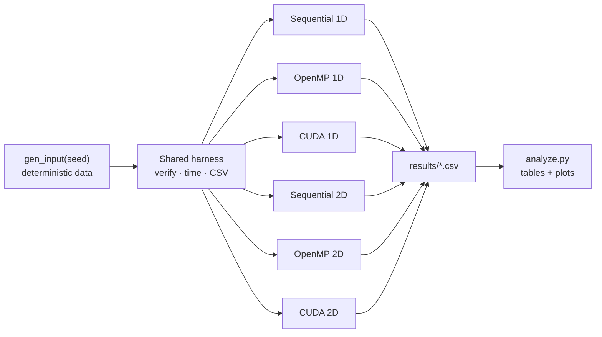

# Parallel FFT: OpenMP vs CUDA

**Six implementations of the Cooley–Tukey Fast Fourier Transform (1D and 2D;
sequential, OpenMP and CUDA), checked for correctness at every size and
benchmarked with one shared methodology. The goal is to measure when CPU or GPU
parallelism actually pays off.**


> CSC 548 Parallel Systems, NC State University, Fall 2026.
> Dhruva Kamble and Om Kumar Singh.

---

## Highlights

- **Correct at every scale.** Every implementation is checked against an O(N²)
  double-precision DFT, and by an `IFFT(FFT(x)) = x` round trip up to 2²⁴
  elements. A common bug in GPU FFTs (using block-level sync across a grid)
  is ruled out by design ([D5](docs/DESIGN.md#d5-cuda-1d-uses-one-kernel-launch-per-stage),
  [D6](docs/DESIGN.md#d6-cuda-2d-uses-one-thread-block-per-row-held-in-shared-memory)).
- **A fair comparison.** All six versions use the same precision, the same
  generated input, the same compiler flags and the same timing harness. CUDA is
  reported both **kernel-only** and **end-to-end**, so PCIe copy time isn't hidden.
- **Two kinds of parallelism.** 1D splits work *inside* a single FFT
  (log₂N barriers). 2D splits it *across* independent row and column FFTs
  (one barrier). The 2D GPU path uses a shared-memory tiled transpose for
  coalesced memory access.
- **Reproducible.** Deterministic input, Slurm job scripts for the NCSU ARC
  cluster, CSV output, and a single script that produces every table and plot.

## Results

*Coming after the ARC benchmark runs.* Running `make analyze` generates:

| | |
|---|---|
| `plots/runtime_1d.png` | `plots/speedup_1d.png` |
| `plots/runtime_2d.png` | `plots/speedup_2d.png` |

along with the full tables in [`results/summary.md`](results/summary.md).
The hypotheses being tested are listed in
[PARALLEL_STRATEGIES.md §5](docs/PARALLEL_STRATEGIES.md#5-hypotheses-to-test-in-the-report).

## How it works



| Version | Parallel strategy | Synchronization |
|---|---|---|
| OpenMP 1D | `omp for` over the N/2 butterflies of each stage | implicit barrier per stage |
| OpenMP 2D | rows in parallel, then columns (per-thread buffer) | one barrier |
| CUDA 1D | one thread per butterfly, one kernel launch per stage; early stages fused in shared memory | kernel boundary = grid-wide barrier |
| CUDA 2D | one block per row in shared memory → tiled transpose → rows → transpose | `__syncthreads()` within a row |

**Read more:** [FFT background](docs/FFT_BACKGROUND.md) covers the algorithm from
scratch. [Parallel strategies](docs/PARALLEL_STRATEGIES.md) explains how each
version maps to hardware. [Design decisions](docs/DESIGN.md) has 13 short
decision records. The [Benchmarking](docs/BENCHMARKING.md) doc describes the
methodology.

## Quick start

```bash
make            # builds CPU versions; CUDA too if nvcc is found
make check      # correctness tests (naive DFT + round trip)
make bench      # benchmark sweep -> results/*.csv
make analyze    # -> results/summary.md + plots/  (pip install pandas matplotlib)
```

Run one implementation directly:

```bash
./bin/cpu1d --impl omp --size 1048576 --reps 5    # CSV rows on stdout
./bin/cuda2d --size 1024 --check                  # PASS/FAIL with error values
```

On macOS, OpenMP needs Homebrew GCC (`brew install gcc`). The build picks it
up automatically. On ARC, use `sbatch scripts/slurm/bench_{cpu,gpu}.slurm`.

## Repository layout

```
common/      shared types, input generator, reference DFT, error metric, timer, harness
cpu1d/       sequential + OpenMP 1D FFT                       (Dhruva)
cpu2d/       sequential + OpenMP 2D FFT                       (Om)
cuda1d/      CUDA 1D FFT                                      (Om)
cuda2d/      CUDA 2D FFT: row kernel + tiled transpose        (Dhruva)
scripts/     check.sh, bench.sh, analyze.py, slurm/ job files
docs/        FFT background, parallel strategies, design decisions, benchmarking
results/     benchmark CSVs + generated summary
plots/       generated figures
report/      LaTeX course report
```

## Team

| | Sequential | OpenMP | CUDA |
|---|---|---|---|
| **Dhruva Kamble** | 1D | 1D | 2D |
| **Om Kumar Singh** | 2D | 2D | 1D |

Each of us owns one sequential, one OpenMP and one CUDA implementation.

## References

1. J. W. Cooley and J. W. Tukey, "An Algorithm for the Machine Calculation of Complex Fourier Series," *Math. Comp.*, 19(90), 1965.
2. L. L. Zhao et al., "CUDA-Based High-Speed FFT Calculation," *Application Research of Computers*, 2011.
3. D. Takahashi, M. Sato, T. Boku, "An OpenMP Implementation of Parallel FFT and Its Performance on IA-64 Processors," *LNCS* 2716, Springer, 2003.
